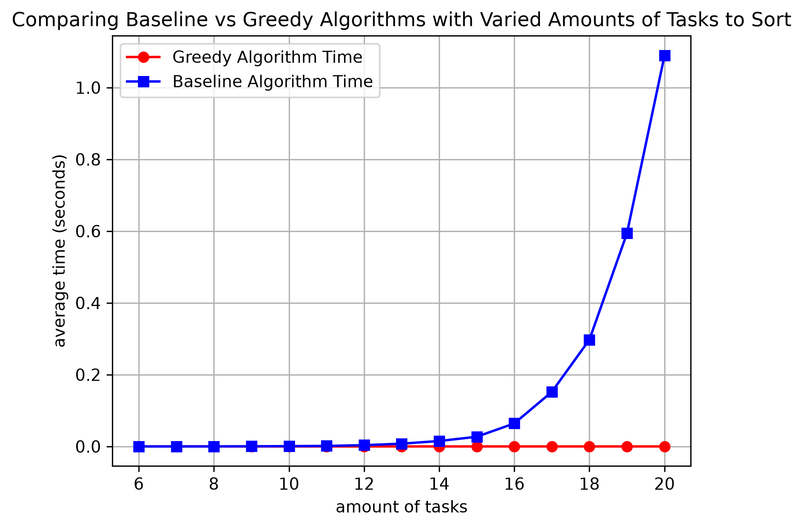
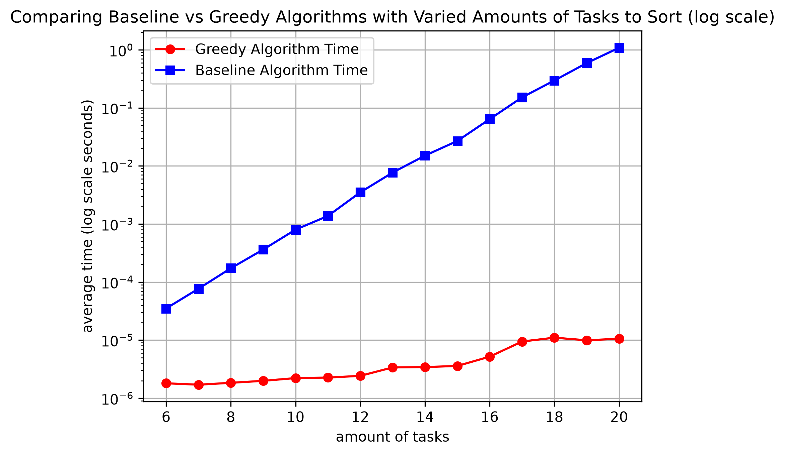

# Freelancing Schedule Problem

## Problem Formulation

The objective of this Freelance Task problem is to create a schedule using a given list of tuples that maximizes revenue. We are provided a list of tuples of size two denoted as Tasks = [(Deadline1 , Pay1), (Deadline 2, Pay 2), …, (Deadline n, Pay n)]. The constraints of this problem is that only one task can be worked on at one time, and that task takes 1 day to complete. Each item in the list is designated as a tuple that has two elements: deadline corresponding to the day which the task must be completed by or it will be unable, and pay corresponding to the revenue that will be gained by completing the task. Our goal is to design an algorithm that both returns a schedule that has been specifically chosen because it produces the maximum amount of revenue with the deadlines, and returns the maximum revenue of that schedule when it is completed. 

## Baseline Solution

The baseline we created tried every possible group of tasks, then sorts by deadlines and includes the ones that fit the deadline. For every group that works, it adds up the pay and saves it if it beats the best total so far, then tries again with a new subset. It’s a “dumb” way because the number of groups grows exponentially, so it gets extremely slow as tasks add up, but it works because checking every possible group means it will guarantee that the best one is in there. 

```text
Algorithm freelanceTasksBaseline(tasks)
    input: list of tuples of size two with the two elements being ‘deadline’ and ‘pay’
    output: list of tuples of size two corresponding to the desired schedule and an int corresponding to maximum revenue
    max_revenue = 0
    best_schedule = []

    for i in range(1, len(tasks) + 1):
        for subset in combinations(tasks, i):
        # Takes all combinations of the tasks from the input list and makes each a subset

            current_schedule = list(subset) # convert the subsets of combinations to lists
            Sort current schedule to check for deadlines
            is_valid = True
            current_revenue = 0

            for day, (deadline, pay) in enumerate(current_schedule, start=1):
                if day > deadline:
                    is_valid = False
                    break
                    # because the deadline was missed
                current_revenue = current_revenue + pay

            if is_valid and current_revenue is more than max_revenue:
                max_revenue = current_revenue
                best_schedule = current_schedule

    return max_revenue, best_schedule
    client_tasks = [(2, 50), (1, 45), (2, 40), (1, 60)]
    revenue, schedule = freelance_tasks(client_tasks)
```

## Algorithmic Strategy

To efficiently find the optimal schedule with the biggest payout, we use a greedy algorithm strategy that sorts through the ‘tasks’ list and pairs the biggest payout tuple with the closest it can get to the deadline as possible without going over.  

We begin by sorting the list of tuples by highest pay first (the second element in each tuple). We set a max_deadline that takes the maximum of the deadlines of the list (the first element in each tuple). An empty list is created based off the max_deadline. The algorithm goes through the entire 'tasks' list finding which tasks can be completed the latest that has the most payment. From there, the tasks is placed into the empty list at that day's index. In the end, the algorithm will iterate through the entire ‘tasks’ list making sure that each day in schedule is filled with the most profitable task, and return a list of tuples with the most profitable schedule. 

```text
Algorithm freelanceTasksGreedy(tasks):
   input: list of tuples of size two with the two elements being ‘deadline’ and ‘pay’
   output: list of tuples of size two corresponding to the desired schedule and an int corresponding to maximum revenue
  
   Sort list ‘tasks’ by highest pay first
   max_deadline = max(deadline for deadline, _ in tasks)
   schedule = list of none * max_deadline + 1
   revenue = 0
   for deadline, pay in tasks:
       for day in range of the minimum of deadline - 1 to max_deadline to -1, going down by 1:
           if schedule[day] is None:
               schedule[day] = (deadline, pay)
               revenue += pay
               break
       return revenue, schedule
```

## Complexity Analysis

**Baseline solution** operates at a worst-case time complexity of $\mathcal{O}(2^n * nlogn)$. This is due to the subset for combinations part simplifying to an tight bound asympotic running time of 2^n and the sort function in the inner loop simplifying to a tight bound running time of nlogn. This results in the worst case, the total work has a tight bound asympotic running time of $\mathcal{O}(2^n * nlogn)$.   

**Greedy algorithm** can be simplified to a outer loop that runs n times and inner loop n that runs n times that contains inner code of linear time. This results, in the worst case, a tight bound asympotic running time of $\mathcal{O}(n^2)$

# Empirical Evaluation

## Test Suite
To test the first error case we ran our algorithm with random, mixed deadlines and pay offs just to test that it covers a buch of numbers. Here are some example outputs (revenue, then (schedule)):
- (315, [(1, 65), (3, 65), (3, 90), (5, 35), (5, 60)])
- (397, [(1, 65), (2, 55), (3, 65), (5, 60), (5, 70), (6, 42), (7, 40)])

Then, the next case we wanted to check was if all the tasks were due on the same deadline, to make sure it simply returned the highest pay because only one of the tasks can be done on that certain day. Here is an example output:
- (90, [(1, 90)])

The next case we thought to check was simply what if there were no tasks given and therefore no schedule to make. We added a line to raise a ValueError if this case ever was to happen and this was just to make sure it actually works. Here is the output:
- raise ValueError("Task list cannot be empty.")
ValueError: Task list cannot be empty.

The final case we thought to check was if the deadlines were farther away and everything can be completed, to make sure the algorithm sorts by deadline correctly and then adds the associated pay to the revenue if so. This will also show that there was nothing done on an empty day as well, by returning None to show no money was made on that day. Here is the example: 
- (619, [None, None, None, None, None, None, None, None, None, (10, 50), (11, 45), (12, 40), (13, 60), (14, 45), (15, 90), (16, 34), (17, 35), (18, 65), (19, 60), (20, 65), (21, 30)])

## Benchmarking Test
We compare the performance of the two algorithms on randomly generated lists of different amounts of tuples (size 6 tasks to 20 tasks) with randomized deadlines between 1-10 and payment 10-100. We present the results in the left graph which shows the time on a linear scale while the right graph in a log scale. 
 | 
|---|---|


## Benchmark Reflection
In comparing our baseline solution to the optimized greedy soltion in an empirical benchmarking test, we can see that the optimized solution is much faster overall and does not grow at the same rate as the baseline. We can see this more clearly in the log scale graph where the baseline algorithm seems to be growing at a linear rate. If it is growing at a linear rate at a log scale, then the graph is growing at a exponential rate in linear as shown in the linear graph. However, in both graphs it is shown that the greedy algorithm is growing too slowly to show its true form of $\mathcal(n^2)$. Before, we did not use multiple tests and average out the times, so we had random dips in our graphs. Now we test it 10 times per list size, so we can better show the true nature of the running time of each algorithm. Overall, the greedy algorithm proves to be more effcient as the amount in the list of tasks increases due to the baseline having a greater growth rate than the greedy. 

## Project Reflection
This project allowed our team to develop baseline and greedy algorithms, evaluate the asymptotic running times of each algorithm, create test suites to confirm the efficiency of our algorithm, and create graphs that compare the running times of the two algorithms. These concepts are incredibly useful to help us as programmers to approach different projects with the most efficient way possible. If this project were true and real, it would be incredibly helpful to have an algorithm that can efficiently sort through hundreds of available tasks. Although we only tested 20 different tasks, we can ensure that, based off the growth of our greedy algorithm, it will be able to handle an increased amount of tasks better than the baseline approach. Our algorithm could be further improved for real life use by implementing user input to confirm the amount of days that the freelancer may have available. We could also implement the ability to read csv files of a large group of tasks, so that the algorithm can sort through and select the most profitable schedule from the file. These improvements could result in our project becoming a great real life resource. 